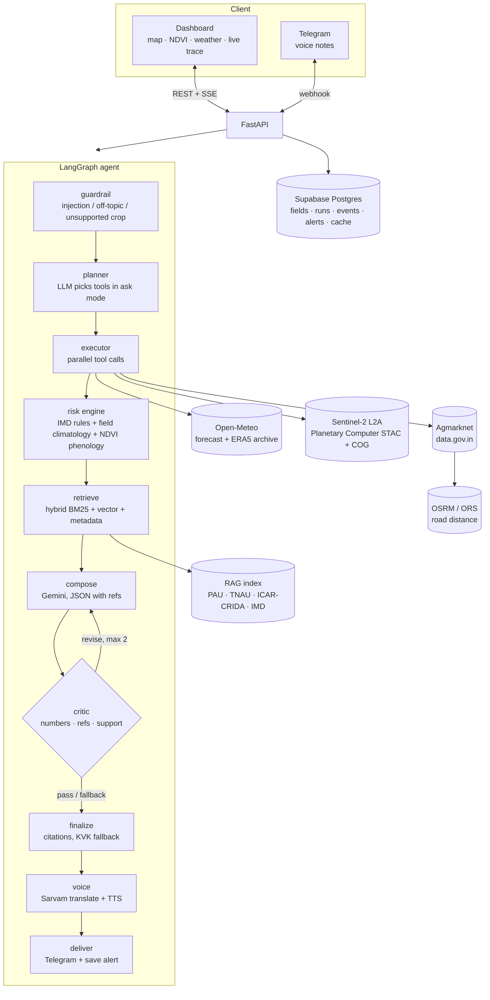

# KhetRakshak — field-level crop risk agent

> An AI agent that watches a farmer's **own field** from satellite and weather data, spots crop risks days before they hit, and pushes a **source-cited voice alert** in the farmer's language with a concrete action plan.

**Track:** Theme 2 — Climate, Resource Infrastructure & Global Supply Resilience (Problem #2 Predictive Micro-Location Yield Engine + Problem #1 Multilingual Agritech Advisory)

| | |
|---|---|
| Live app | _add Hugging Face Space URL_ |
| Demo video | _add link_ |
| Pitch deck | _add link_ |

## Problem
Unseasonal rain at harvest, a heat wave at grain filling or a dry spell after sowing can wipe out a season. Today's advisories (IMD district bulletins, Meghdoot, Kisan Suvidha) are **district-level broadcasts**: the same text for lakhs of farmers, often in English, with no link to what is actually happening in *one* field.

**Target users:** smallholder farmers (paddy, wheat, mustard) in Punjab and Tamil Nadu, many with low literacy who prefer voice in their own language; KVKs and FPOs who support them.

## Solution
KhetRakshak is an agent, not a chatbot. For each registered field it:

1. **Sees the field** — Sentinel-2 L2A NDVI computed *inside the farmer's boundary*, with pixel-level cloud masking (Scene Classification Layer) and the same field's NDVI in the previous 3 years as a baseline.
2. **Reads the crop stage from the field itself** — phenology from the field's own NDVI curve (green-up, peak, decline, harvest), cross-checked with the sowing date.
3. **Judges the weather against local normal** — 16-day forecast vs a 10-year climatology of the *same weeks at the same location*; official **IMD criteria** for heavy rain and heat waves, cited to the bulletin page.
4. **Finds official advice** — hybrid retrieval (BM25 + Gemini embeddings, reciprocal-rank fusion, crop/state metadata filters) over PAU, TNAU, ICAR-CRIDA and IMD documents. No supporting passage → "contact your local KVK".
5. **Checks the money** — today's Agmarknet prices at nearby mandis, OSRM road distance, net price after the farmer's *own* transport rate.
6. **Verifies itself** — a critic node checks every number against tool outputs or cited text, every reference exists, every action cites a document; an LLM support check confirms the cited text backs the claim. Failing drafts loop back (max 2); anything still unsupported is removed and replaced by a KVK referral.
7. **Speaks** — Sarvam translation + text-to-speech (Hindi, Tamil, Punjabi, English), delivered as a Telegram voice note. The farmer can reply with a voice question and gets a spoken, cited answer.

### What makes it different
| District bulletin / chatbot | KhetRakshak |
|---|---|
| District average | The farmer's own polygon, 10 m pixels |
| Generic thresholds | IMD criteria + this field's own 10-year normal |
| Unsourced text | Page-level citations, verified by a critic |
| English text | Voice in 4 languages, two-way |
| Weather only | Weather + crop health + mandi net price |
| Silent failure | Labelled fallbacks, visible confidence, "data unavailable" states |

## Architecture



### Tool contract
Every data tool returns `{data, source, source_url, fetched_at, confidence, error, cached, notes}`, with timeouts, retries with exponential backoff, and a fallback chain: next source → **labelled** cache of a previous real response → explicit `data unavailable`. Tools never raise; the agent continues with partial data and says what is missing.

### Repository layout
```
backend/app/
  main.py            FastAPI routes, SSE stream, scheduler, static dashboard
  agents/graph.py    LangGraph state graph (guardrail → … → deliver)
  agents/guardrails.py, agents/events.py
  tools/             base.py (contract) · weather · satellite · market · geo · voice
  risk/engine.py     crop stage + risk rules with citations
  rag/ingest.py      PDF/HTML → page-aware chunks → embeddings
  rag/retrieve.py    hybrid retrieval
  llm.py, db.py, telegram_bot.py, schema.sql
backend/static/      dashboard (HTML/CSS/JS, Leaflet, Chart.js)
data/rag_sources/    sources.csv (official documents)
data/index/          built index (chunks.json + embeddings.npy)
scripts/smoke_test.py  live check of every external API
```

## Data sources (all live or official — no mock data)
| Data | Source | Fallback |
|---|---|---|
| Field NDVI, cloud mask | Sentinel-2 L2A (ESA Copernicus) via Microsoft Planetary Computer | last clear scene, lowered confidence; labelled cache |
| Forecast | Open-Meteo Forecast API | labelled cache |
| Climatology / replay | Open-Meteo Historical Archive (ERA5) | labelled cache |
| Mandi prices | Agmarknet, data.gov.in (Ministry of Agriculture & FW) | labelled cache |
| Road distance | OSRM (OpenStreetMap) | OpenRouteService → straight-line (labelled) |
| Location check | Nominatim (OSM) | BigDataCloud |
| Mandi geocoding | Open-Meteo Geocoding (GeoNames) | district HQ (labelled approximate) |
| Advice | PAU Package of Practices (Rabi 2024-25, Kharif), TNAU Crop Production Guide & Agritech portal, ICAR-CRIDA district contingency plans (Ludhiana, Thanjavur), IMD bulletins | "contact your local KVK" |
| LLM / embeddings | Gemini 2.5 Flash (fallback: Flash-Lite), gemini-embedding-001 | deterministic data-only alert |
| Voice | Sarvam AI (Mayura translate, Bulbul TTS, Saarika STT) | text-only alert |

Risk thresholds come from only two places: **IMD definitions** (cited, with quote and page) and **the field's own history**. Crop-stage heuristics are relative to the field's own NDVI peak.

## Edge cases handled
| Case | Behaviour |
|---|---|
| Cloudy imagery | cloudy pixels masked; last clear scene used; confidence lowered; trace and alert say how old the view is |
| Corrupt satellite scene | detected (invalid reflectance) and skipped, labelled "invalid sensor data" |
| API down / slow | retries → fallback source → labelled cache → "data unavailable"; agent continues |
| LLM down | fallback model → deterministic alert from the risk engine only |
| Point in sea / outside India | rejected with a plain message |
| Field too small (< 0.05 ha) / too large (> 50 ha) / self-intersecting | rejected with reason |
| Unsupported crop | refused with KVK referral |
| Missing sowing date | stage read from NDVI only |
| Sowing date in future / > 9 months ago | rejected |
| Garbled / silent voice | "please repeat" |
| Hinglish / mixed language | Sarvam STT auto-detect + LLM normalisation |
| Off-topic / prompt injection | regex + LLM guardrail refusal, shown in trace |
| Unsourced claim / wrong number | critic rejects, composer revises; still failing → removed + KVK referral |
| Historical replay | same agent on a past date with archived data, clearly labelled |

Use **Demo controls** in the dashboard to switch a live source off and watch the fallbacks.

## Setup

```bash
git clone <repo> && cd <repo>
python -m venv .venv                     # Python 3.12 (keep the venv outside OneDrive/Dropbox)
.venv\Scripts\activate                   # macOS/Linux: source .venv/bin/activate
pip install -r backend/requirements.txt
copy .env.example .env                   # fill in keys (see comments inside)
python scripts/smoke_test.py             # live check of every external API
cd backend
python -m app.rag.ingest                 # only if you change data/rag_sources/sources.csv
uvicorn app.main:app --reload --port 8000
```
Open http://localhost:8000. Locally the Telegram bot runs in polling mode; in production set `PUBLIC_BASE_URL` to use a webhook.

### Deploy (Hugging Face Spaces, Docker)
1. Create a Space with SDK **Docker**.
2. Add every key from `.env.example` as a **Secret** in the Space settings, plus `PUBLIC_BASE_URL=https://<user>-<space>.hf.space`.
3. Push this repository to the Space. The `Dockerfile` serves the app on port 7860.

## Team
_names and roles_
