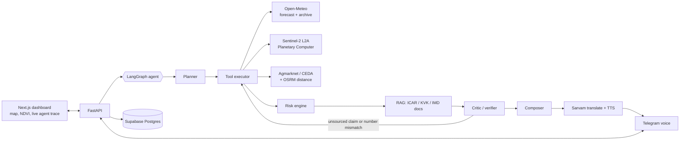

# KhetRakshak

> Field-level, proactive, source-cited crop-risk agent. It watches a farmer's own plot from satellite and weather data and pushes a voice alert with an action plan in the farmer's language.

**Track:** Theme 2 — Climate, Resource Infrastructure & Global Supply Resilience (Problems #2 + #1)

- Live app: _TBD_
- Demo video: _TBD_
- Pitch deck: _TBD_

## Problem
_TBD: who is affected, why district-level bulletins fall short._

## Solution
_TBD: agent workflow overview._

## Architecture



## Data sources
| Data | Source | Fallback |
|---|---|---|
| Weather forecast + history | Open-Meteo | labelled cache |
| Satellite NDVI | Sentinel-2 L2A via Microsoft Planetary Computer | last clear scene, lowered confidence |
| Mandi prices | data.gov.in Agmarknet | CEDA Ashoka, labelled cache |
| Road distance | OSRM | OpenRouteService |
| Voice / translation | Sarvam AI | text-only alert |

## Setup

```bash
python -m venv .venv
.venv\Scripts\activate          # Windows  (source .venv/bin/activate on macOS/Linux)
pip install -r backend/requirements.txt
copy .env.example .env          # then fill in keys
python scripts/smoke_test.py    # checks every external API live
uvicorn app.main:app --reload --app-dir backend
```

## Edge-case handling
_TBD_

## Team
_TBD_
